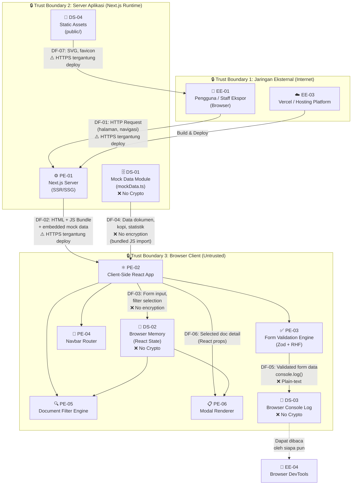

# Data Flow Diagram (DFD) — Nusantara Coffee Export Platform

> **Versi**: sec-0.1  
> **Tanggal**: 2026-10-12  
> **Level**: DFD Level 1

---

## Diagram Aliran Data

---

## Legenda

| Simbol | Arti |
|--------|------|
| 🧑 | External Entity (Entitas Eksternal) |
| ⚙️ / ⚛️ / ✅ / 🧭 / 🔍 / 📋 | Processing Element (Proses) |
| 🗄️ / 💾 / 📝 / 📁 | Data Store (Penyimpanan Data) |
| 🔒 | Trust Boundary |
| ❌ No Crypto | Aset data TIDAK dilindungi kriptografi |
| ⚠️ | Perlindungan kondisional (tergantung konfigurasi) |

---

## Daftar Elemen DFD

### Processing Elements (PE)

| ID | Nama | Trust Boundary |
|----|------|---------------|
| PE-01 | Next.js Server (SSR/SSG) | TB2 — Server Aplikasi |
| PE-02 | Client-Side React App | TB3 — Browser Client |
| PE-03 | Form Validation Engine (Zod + RHF) | TB3 — Browser Client |
| PE-04 | Navbar Router | TB3 — Browser Client |
| PE-05 | Document Filter Engine | TB3 — Browser Client |
| PE-06 | Modal Renderer | TB3 — Browser Client |

### Data Stores (DS)

| ID | Nama | Trust Boundary | 🔒 Kriptografi |
|----|------|---------------|----------------|
| DS-01 | Mock Data Module (`mockData.ts`) | TB2 — Server | ❌ Plain-text hardcoded |
| DS-02 | Browser Memory (React State) | TB3 — Browser | ❌ Tidak ada enkripsi |
| DS-03 | Browser Console Log | TB3 — Browser | ❌ Plain-text |
| DS-04 | Static Assets (`public/`) | TB2 — Server | ❌ Tidak ada |

### External Entities (EE)

| ID | Nama | Trust Boundary |
|----|------|---------------|
| EE-01 | Pengguna / Staff Ekspor | TB1 — Jaringan Eksternal |
| EE-03 | Vercel / Hosting Platform | TB1 — Jaringan Eksternal |
| EE-04 | Browser DevTools | Di luar semua boundary |

### Data Flows (DF)

| ID | Dari → Ke | Data | 🔒 Perlindungan Transit |
|----|-----------|------|------------------------|
| DF-01 | EE-01 → PE-01 | HTTP request (halaman) | ⚠️ HTTPS jika deploy ke Vercel; HTTP di dev |
| DF-02 | PE-01 → PE-02 | HTML + JS bundle + mock data | ⚠️ Sama seperti DF-01 |
| DF-03 | PE-02 → DS-02 | Form input, filter selection | ❌ In-memory, tidak dienkripsi |
| DF-04 | DS-01 → PE-02 | Data dokumen, kopi, statistik | ❌ Embedded di JS bundle |
| DF-05 | PE-03 → DS-03 | Validated form data | ❌ Plain-text console.log |
| DF-06 | PE-02 → PE-06 | Selected document detail | ❌ React props (in-memory) |
| DF-07 | DS-04 → EE-01 | Static assets (SVG, favicon) | ⚠️ HTTPS jika deploy |

---

## Trust Boundaries

### TB1 — Jaringan Eksternal (Internet)
- **Scope**: Komunikasi antara browser pengguna dan server via internet
- **Risiko**: Man-in-the-Middle jika tidak menggunakan HTTPS, penyerang mengintercept request
- **Entitas**: EE-01 (Pengguna), EE-03 (Hosting)

### TB2 — Server Aplikasi (Next.js Runtime)
- **Scope**: Proses server-side rendering, bundling, dan serving static assets
- **Risiko**: Akses ke source code dan mock data jika server terkompromi; supply-chain attack via npm
- **Entitas**: PE-01, DS-01, DS-04

### TB3 — Browser Client (Untrusted Environment)
- **Scope**: Semua kode yang berjalan di browser pengguna — sepenuhnya di bawah kendali pengguna
- **Risiko**: Manipulasi state, injeksi script, akses ke data di memory dan console
- **Entitas**: PE-02, PE-03, PE-04, PE-05, PE-06, DS-02, DS-03

> [!CAUTION]
> **Semua data yang masuk ke TB3 (Browser) harus dianggap terekspos.** Browser adalah untrusted environment — data di React state, console log, dan JS bundle dapat diakses oleh siapa pun yang memiliki akses ke browser, termasuk ekstensi berbahaya dan shared workstation.

